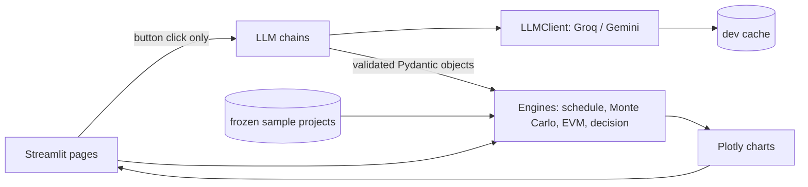

# PlanPilot AI: Build Plan (v2)

> One paragraph in, a full project plan out: WBS, schedule, risk register, Monte Carlo forecast, earned-value status report and a decision memo.
> Solo build by Krish with Claude Code. **Deadline: Friday 30 Oct 2026, night.** Windows, Python 3.11+.

## 1. Goal and theme coverage

Report theme: *How AI can support project planning, execution, risk management, and decision-making across real project environments.*

| Theme | What the app does | Who does the work |
|---|---|---|
| Planning | Brief -> WBS with three-point estimates and dependencies -> CPM schedule + Gantt + plan checks | LLM proposes, code schedules and checks |
| Execution | Weekly progress -> PV/EV/AC, SPI/CPI, EAC, RAG status report | Code computes, LLM narrates |
| Risk management | Risk register, 5x5 heatmap, Monte Carlo P50/P80/P90, criticality, tornado | LLM drafts, code scores and simulates |
| Decision-making | 2-3 options re-simulated, weighted scoring with weight-sensitivity, decision memo | Code ranks, LLM writes memo |

**Core design rule: the LLM proposes, the code verifies.** The LLM never computes a metric. Every number on screen comes from deterministic, seeded, tested Python.

**"Real project environments":** the app ships three environment presets with their own roles and rates: **software** (college placement portal), **event** (college tech fest), **construction** (campus lab renovation). Showing the same pipeline on three different environments is the report's evidence of generality. Optional fourth case: a real event or project Krish has actually run, with real planned-vs-actual dates (see section 9).

## 2. Decisions already made

- **UI:** Streamlit multipage app calling the Python package directly. No FastAPI (stretch only).
- **Charts:** Plotly.
- **LLM:** one `openai` SDK client pointed at OpenAI-compatible endpoints.
  - Primary: Groq, model `openai/gpt-oss-120b`. At P0 confirm the model id with `client.models.list()`; free-tier model lists change often.
  - Fallback: Gemini via its OpenAI-compatible endpoint; model name from env var `GEMINI_MODEL` (use a Flash-Lite model; check the quota in AI Studio).
  - Third mode: offline, using frozen sample projects (section 9).
- **Validation:** Pydantic v2 schema checks plus semantic plan checks (section 7). Invalid output triggers a retry with the error text appended (max 3 attempts).
- **Simulation:** NumPy, 10,000 iterations, triangular distribution, fixed seed, common random numbers across options.
- **Build order: engines first, LLM second.** Engines run on a hand-written frozen sample project, so the "never cut" core works offline by Thursday night. The LLM layer is added Friday morning.

## 3. Architecture



## 4. Repo structure

```
planpilot-ai/
  app/
    Home.py                  # environment preset, brief input, generate or load demo
    pages/
      1_Plan.py              # WBS table + Gantt + critical path + plan checks
      2_Risks.py             # register + heatmap
      3_Simulation.py        # Monte Carlo charts
      4_Execution.py         # EVM dashboard + RAG report
      5_Decide.py            # options, scores, weight sensitivity, memo
  planpilot/
    config.py                # presets (roles, rates, headcount), seeds, thresholds, env loading
    models.py                # Pydantic models + validators
    llm/
      client.py              # LLMClient (provider switch, retry, JSON parse)
      cache.py               # hash-keyed dev cache
      chains.py              # plan_chain, risk_chain, status_chain, memo_chain
    engine/
      schedule.py            # topo sort, CPM, plan semantic checks
      montecarlo.py          # vectorised simulation, percentiles, criticality, sensitivity
      evm.py                 # time-phased planned %, simulate_progress, PV/EV/AC, SPI/CPI/EAC, RAG
      decision.py            # apply options, re-simulate, scoring, weight scenarios
    viz.py                   # all Plotly figure builders
  prompts/                   # wbs.md, risks.md, status.md, memo.md (versioned, with few-shot)
  data/
    sample/                  # COMMITTED frozen projects (*.json) + progress CSVs
    cache/                   # gitignored dev cache
  scripts/
    make_demo_data.py        # builds/validates frozen projects, calibrates deadlines, writes progress CSVs
    consistency_check.py     # LLM consistency evaluation (cache bypassed)
    export_figures.py        # OPTIONAL: Plotly -> PNG via kaleido
  tests/
  docs/                      # images/, rubric.md, consistency.csv, demo.gif
  .github/workflows/ci.yml
  .env.example  .gitignore  .gitattributes  LICENSE (MIT)  README.md  requirements.txt  CLAUDE.md  PLAN.md
```

## 5. Data models (`planpilot/models.py`)

- **Task:** `id` ("T01"...), `name`, `phase`, `role`, `optimistic`, `most_likely`, `pessimistic` (working days, o <= m <= p), `depends_on: list[str]`.
- **Risk:** `id` ("R01"...), `title`, `category` (technical, schedule, resource, scope, external, quality), `cause`, `event`, `effect`, `probability` (0-1), `impact_days`, `affected_task_ids`, `owner_role`, `response_strategy` (avoid, mitigate, transfer, accept), `response`.
- **Project:** `name`, `environment` (software / event / construction), `brief`, `start_date`, `deadline`, `team: dict[role, headcount]`, `tasks`, `risks`.
- **Option:** `name`, `description`, `changes: list[Change]`. `Change.type`:
  - `add_resource` (role, added_people k, efficiency e)
  - `cut_scope` (task ids; dependents are rewired to the removed task's predecessors)
  - `mitigate_risk` (risk ids, probability multiplier, one-off cost) **links the risk register to decisions**
  - `extend_deadline` (days)
- Validators: unique ids, `depends_on` references existing ids, **no cycles** (a cycle raises a validation error and triggers an LLM retry), roles belong to the environment preset.
- **Cost model (assumption stated in README):** task cost = sampled duration x daily rate of its role (rates in `config.py` presets, INR, e.g. dev 4000, tester 3000). One person-equivalent per task; headcount only matters for `add_resource`.

## 6. LLM layer spec

- `LLMClient.complete_json(prompt_name, variables, schema_cls, use_cache=True, temperature=0.2) -> schema_cls`.
- Render `prompts/<name>.md`, call provider, strip code fences, parse, validate, retry with the error appended.
- **Cache is a dev-speed and quota-saving tool only.** Key = sha256(provider + model + prompt_name + rendered prompt + schema name + temperature). It is NOT the offline demo mechanism (editing a prompt invalidates keys). The offline demo uses frozen projects (section 9).
- `use_cache=False` must truly bypass reads and writes (needed by `consistency_check.py`).
- **Streamlit reruns on every widget interaction. LLM calls happen only inside an explicit button click**; results go into `st.session_state`. Never call the LLM at module level or in a plain page body.
- Load keys from `.env` with python-dotenv. Never log or commit keys.
- **Prompt rules** (each prompt file has one few-shot example and the allowed roles for the chosen environment):
  - `wbs.md`: 15-25 tasks, 4-6 phases; ids T01...; working-day durations; dependencies reference earlier ids only; at least two parallel paths; JSON only.
  - `risks.md`: 8-12 risks; cause-event-effect wording; probability 0.05-0.9; realistic `impact_days`; real task ids; several categories.
  - `status.md`, `memo.md`: receive precomputed numbers; instruction "use only the numbers provided, do not calculate or invent figures"; structured sections.

## 7. Engine specs

**schedule.py:** topological sort; forward/backward pass on most-likely durations; slack; critical path; calendar dates via `numpy.busday_offset` from `start_date`.

**Plan semantic checks** (`check_plan(project) -> errors, warnings`):
- Errors (trigger LLM retry): cycle, unknown dependency/role/task id, fewer than 12 or more than 30 tasks, a phase with fewer than 2 tasks.
- Warnings (shown in a "Plan checks" panel, good screenshot material): non-terminal task with no successor, only one start task, no parallel paths, CPM duration outside 0.5x-2x of the stated timeframe, a risk category missing.

**montecarlo.py** (pure function with `seed`):
1. Sample durations with `rng.triangular(o, m, p)` for all tasks x iterations at once.
2. Add discrete risk events: Bernoulli(probability) x `impact_days` on affected tasks.
3. Vectorised forward pass in topological order -> project duration per iteration.
4. Vectorised backward pass -> slack per task per iteration; criticality index = share of iterations with slack <= 1e-9.
5. Cost = sum(sampled duration x role rate) + one-off option costs.
6. Outputs: P50/P80/P90 duration and cost, probability of meeting deadline, histogram data, S-curve, criticality index, tornado (correlation of each task's duration with project duration).
- Use the **same seed for every option** (common random numbers) so differences come from the option, not sampling noise.

**evm.py:**
- `planned_pct(project, week)`: per task, linear between CPM early start and early finish (0 before, 1 after).
- `simulate_progress(project, as_of_week, slip, cost_overrun, seed)`: generates weekly actual % and actual cost per task from the **current** project plan (slip multiplies durations with noise). This fixes the problem that a pre-made CSV cannot match an LLM-generated task list. CSV upload stays as an optional input.
- BAC = sum(most-likely duration x rate). Per week: PV = sum(planned_pct x budget), EV = sum(actual_pct x budget), AC = sum(actual_cost). SPI = EV/PV, CPI = EV/AC, EAC = BAC/CPI, VAC = BAC - EAC.
- RAG (thresholds configurable): green if both indices >= 0.95, amber if the lower is 0.85-0.95, red if < 0.85.

**decision.py:**
- Apply each Option to a deep copy of the project, re-run Monte Carlo (same seed), collect metrics.
- `add_resource`: tasks of that role get duration x 1/(1 + e*k/n) with n = current headcount of the role and e = 0.6 by default (e < 1 models coordination overhead, cf. Brooks's law); cost adds k x rate x affected task-days.
- `mitigate_risk`: multiply the chosen risks' probabilities, add the one-off cost.
- Criteria and default weights: P80 finish 0.35, probability of meeting deadline 0.30, expected cost 0.25, spread (P90-P50) 0.10. Min-max normalise (invert lower-is-better), weighted sum.
- **Weight scenarios:** balanced (0.35/0.30/0.25/0.10), schedule-first (0.45/0.35/0.10/0.10), cost-first (0.20/0.20/0.50/0.10). Show the ranking under each and flag whether the winner is stable. Always show raw metric values next to normalised scores (min-max on 2-3 options exaggerates small gaps).

## 8. Streamlit pages

Sidebar on every page: provider, offline toggle (frozen projects only), seed, "load demo project". Project state lives in `st.session_state`. Simulation results cached with `st.cache_data` keyed on project hash + seed. Each page has a "How this was computed" expander (supports the report and the LLM-vs-code story).

## 9. Demo data and frozen projects (`scripts/make_demo_data.py`)

- Three **frozen, validated project JSONs** in `data/sample/`, one per environment (software, event, construction), 15-22 tasks and 8-10 risks each. Claude Code writes them by hand/script, not via the LLM, so the demo works with no API key. Optionally replace them with real LLM output after P6, then freeze again.
- **Deadline calibration:** after simulating the baseline, set each project's deadline at about the baseline P65 so the probability of meeting it is neither 0% nor 100% and the decision module has something real to improve.
- Each project gets a weekly progress CSV produced by `simulate_progress` with injected slippage (SPI drifting to about 0.82, CPI about 0.9 by the as-of week) so the status report flags something.
- **Optional real case (high value for "real project environments"):** if Krish has a real project or event he ran (task list, planned dates, actual dates, rough costs), encode it as a fourth frozen project with real planned-vs-actual progress. Use only non-sensitive data.

## 10. Phases and time boxes (re-timed from Thu 29 Oct, 21:22)

Budget is about 17 working hours. Claude Code does most of the typing; Krish's time goes to reviewing, running, fixing and capturing screenshots. Commit and push after every phase. Capture screenshots into `docs/images/` the moment each page works.

**Thursday night (stop by 01:00, sleep)**
- [x] **P0 Setup (21:40-22:15):** repo (create on GitHub and push now), venv, `.env.example`, `.gitignore`, `.gitattributes` (`* text=auto`), MIT licence, folders, `requirements.txt`, Groq key + model id check. *Exit: `streamlit run app/Home.py` shows a blank page; a hello call to the LLM returns text.*
- [x] **P1 Models + presets + frozen project (22:15-23:00):** `models.py` with validators, `config.py` presets, one hand-written frozen software project. *Exit: loads and validates; cycle and bad-id tests fail as expected.*
- [x] **P2 Schedule + Gantt + plan checks (23:00-00:00):** `schedule.py`, `check_plan`, `viz.gantt`, page 1 loading the frozen project. *Exit: Gantt with critical path highlighted, works offline.*
- [x] **P3 Monte Carlo engine + tests (00:00-01:00):** `montecarlo.py` and its tests. *Exit: percentiles, criticality, tornado data and passing tests. If not done by 01:00, stop and finish at 08:00.*

**Friday**
- [x] **P4 Simulation charts + page 3 (08:00-09:15):** histogram with P-lines, S-curve, tornado, criticality chart.
- [x] **P5 LLM layer + plan chain (09:15-10:45):** `client.py`, `cache.py`, `wbs.md`, `plan_chain`, Home page generate button. *Exit: brief -> valid plan; button-only calls; retry works.*
- [x] **P6 Risk chain + register + heatmap (10:45-12:00):** `risks.md`, `risk_chain`, page 2, risks wired into the simulation.
- [x] **MVP CHECKPOINT (12:15):** brief -> plan -> risks -> simulation works end to end, offline demo works, tests pass, basic README pushed. **If not true by 13:00, stop adding features and fix it.**
- [x] **P7 EVM + status report (13:00-14:30):** `evm.py`, `simulate_progress`, gauges, PV/EV/AC curves, `status_chain`, page 4. Two further frozen projects (event, construction) added here.
- [x] **P8 Decision module (14:30-16:30):** `decision.py`, three demo options, weight scenarios, `memo_chain`, page 5.
- [ ] **FEATURE FREEZE (16:30).**
- [ ] **P9 Tests, CI, evaluation (16:30-17:45):** 10+ pytest tests, GitHub Actions (ubuntu-latest, Python 3.11, ruff + pytest, `PLANPILOT_OFFLINE=1`, no secrets), run `consistency_check.py`, fill `docs/rubric.md`, final screenshot pass.
- [ ] **P10 README + GIF + diagram (17:45-18:45).**
- [ ] **P11 Report assembly (18:45-22:30):** drop figures and tables into the pre-drafted report. Leave at least 60 minutes of margin before the real deadline.

**Run in parallel (in the claude.ai chat, while Claude Code builds):** draft Title, Objective, Introduction and References for the report. These do not depend on the app.

**Cut list, in this order, if behind:** `export_figures.py`, theming polish, LLM-written status text (use a template), `mitigate_risk` and `add_resource` options (keep `cut_scope` and `extend_deadline`), the second and third environments (keep one). **Never cut:** Monte Carlo, engine tests, README, offline demo, the plan checks, the report.

## 11. Tests (`tests/`)

- schedule: known small network gives the expected critical path and duration; cycle detection; `check_plan` flags each error and warning case.
- montecarlo: single task mean ~ **(o + m + p)/3** (triangular mean, NOT the PERT (o + 4m + p)/6) within tolerance; deterministic with seed; P50 <= P80 <= P90; with probabilities 0 and o=m=p the result equals the CPM duration; same seed gives identical results across options.
- evm: hand-calculated SPI/CPI/EAC example; planned % is 0 before ES and 1 after EF; `simulate_progress` is deterministic and keyed to the given plan; RAG thresholds.
- decision: `cut_scope` reduces P80; `extend_deadline` raises probability of meeting the deadline; `mitigate_risk` lowers risk-driven spread; `add_resource` shortens that role's tasks but raises cost; weight scenarios sum to 1.
- models: bad dependency id rejected; o > m rejected; unknown role rejected.
- llm: mocked provider returns invalid JSON once, valid on retry; `use_cache=False` bypasses cache; offline mode never touches the network.

## 12. Evaluation (feeds the Result section honestly)

There is no ground truth for plan quality, so use two light-weight, transparent checks:
1. **Consistency:** `consistency_check.py` runs the plan and risk chains 3 times per demo brief with `use_cache=False` and temperature 0.7. Table: task count, total most-likely days, critical-path days, risk count per run.
2. **Rubric:** `docs/rubric.md`, Krish scores one generated plan per environment from 0-2 on: scope coverage, dependency logic, estimate plausibility, parallelism, risk specificity, risk-category coverage, response actionability, role fit. Report the scores and say they are a single-rater judgement.

## 13. README checklist

Hero banner/GIF, one-line pitch, badges (Python 3.11, MIT, CI, Streamlit), features with screenshots, Mermaid architecture diagram, quickstart (Windows PowerShell), offline demo instructions, how it works (prompt chain, simulation, "LLM proposes, code verifies"), results, limitations and ethics (hallucination, synthetic data, no ground truth, single-person cost model), roadmap, references, author. GitHub topics: `project-management`, `llm`, `monte-carlo`, `streamlit`, `earned-value`.

## 14. Screenshots for the Result section

1. Home page with brief and environment preset. 2. WBS table + plan checks panel. 3. Gantt with critical path. 4. Risk register + heatmap. 5. Monte Carlo histogram with P50/P80 + S-curve. 6. Tornado / criticality. 7. EVM dashboard + RAG report. 8. Decision comparison + weight-scenario table + memo. 9. The same pipeline on the other two environments (one screenshot each). 10. pytest/CI passing + README hero. Plus the consistency table and rubric table.

## 15. Report mapping

Title -> Objective (four goals) -> Introduction (problem, state of AI in PM, related work, scope, architecture) -> Result/Output (figures 1-10 with caption and 2-3 lines of interpretation each, consistency and rubric tables, decision table) -> Conclusion (what worked, limitations, human-in-the-loop, future work) -> References (12-15 from the research report). State plainly that plan quality has no ground truth, the cost model assumes one person per task, and demo projects are synthetic unless the real case is used.

## 16. Windows setup and pitfalls (PowerShell)

```powershell
mkdir planpilot-ai; cd planpilot-ai
git init
py -3.11 -m venv .venv
.venv\Scripts\Activate.ps1          # if blocked: Set-ExecutionPolicy -Scope CurrentUser RemoteSigned
pip install -r requirements.txt
Copy-Item .env.example .env         # then add GROQ_API_KEY (and GEMINI_API_KEY, GEMINI_MODEL)
streamlit run app/Home.py
pytest -q
```

`requirements.txt`: streamlit, plotly, pandas, numpy, pydantic>=2, openai, python-dotenv, pytest, ruff (kaleido only if `export_figures.py` is attempted; recent versions may need Chrome installed).

Windows pitfalls: always `open(..., encoding="utf-8")` and `Path.read_text(encoding="utf-8")` (the default cp1252 breaks on symbols such as the rupee sign); use `pathlib`, never hard-coded backslashes; keep `.venv` out of git.

## 17. Decisions

- P0: no `py` launcher on this machine; create the venv with `python -m venv .venv` (Python 3.11.9).
- P0: no real project data, so the optional fourth (real) case in section 9 is dropped. Demo projects are synthetic.
- P0: provider order is Groq first. Switch to Gemini only when Groq returns a daily-quota 429; a per-minute 429 waits and retries on Groq.
- P0: Groq model `openai/gpt-oss-120b` confirmed via `models.list()`. Gemini ids come back as `models/<id>`; default `GEMINI_MODEL` is `models/gemini-flash-lite-latest` (the exact id tested with a hello call).
- P1: `planpilot` is installed editable (`pip install -e .`, config in `pyproject.toml`) so plain `streamlit run` and `pytest` can import it. `requirements.txt` includes `-e .`, so the normal install covers it.
- P1: cycle detection lives in `models.topological_order`; `schedule.py` reuses it.
- P1: the frozen software project's deadline (2027-01-08) is a placeholder until calibration to about P65 in `make_demo_data.py`.
- P2: `check_plan` holds only the count and phase errors plus the warnings. Structural errors (cycle, unknown id or role) come from Pydantic validation; both kinds feed the LLM retry.
- P2: "stated timeframe" = working days from `start_date` to `deadline`. "No parallel paths" = no two tasks overlap in the most-likely CPM schedule. "Risk category missing" fires when fewer than 3 of the 6 categories are covered. "Non-terminal task with no successor" = a task with no successor that finishes before the project end.
- P2: a task occupies working days [ES, EF); `finish` is its last working day (inclusive).
- P3: `deadline_days` = working days from start up to and including the deadline; on time iff duration <= deadline_days. The Gantt deadline line sits at the end of the deadline day. Calibration sets deadline = `busday_offset(start, ceil(P65) - 1)`.
- P3: triangular sampling uses the inverse CDF on uniform draws (`rng.triangular` fails when o = p). Each task and risk has its own random stream `default_rng([seed, id number])` (risks offset by 1000), so cutting a task leaves every other draw unchanged. A risk fires when its uniform draw < probability, so lowering a probability only removes events.
- P3: risk-delay days are charged at the affected task's role rate.
- P3: lowering a risk probability lowers every percentile but not always the P90-P50 spread (a frequent risk shifts P50 as well). The P8 `mitigate_risk` test asserts lower P80/P90, or spread only on a case where it holds.
- P4: `make_demo_data.py` currently only validates and calibrates (progress CSVs come in P7). It rewrites just the `deadline` field so the hand-written JSON layout stays; it is idempotent. Software deadline: 19 Jan 2027 (57 working days, P(on time) 0.68 at seed 42).
- P4: the simulation cache lives in `planpilot/ui.py` (`st.cache_data` keyed on the project JSON + seed), keeping Streamlit out of `engine/`. Seed and demo choice are stored under plain session keys because Streamlit drops widget state on page switch.
- P4: ruff pinned to 0.17.3 with an explicit rule set so CI lints the same way.
- P5: the LLM returns only `{name, tasks}` (`WBSDraft`); `plan_chain` builds the `Project` from the Home inputs and the preset team. `complete_json` takes an optional `check` callable, and JSON errors, Pydantic errors on the assembled `Project` and `check_plan` errors all trigger a retry.
- P5: prompts use `string.Template` (`$var`), because the JSON few-shot has braces. The retry text lives in `prompts/retry.md`; appended errors are cut to 10 lines. Few-shot examples are per environment in `prompts/examples/`.
- P5: the SDK runs with `max_retries=0`. A 429 that mentions a daily limit (TPD/RPD, "per day") switches to Gemini for the rest of the server process; any other 429 gets one bounded wait (at most 30 s) and one retry. `finish_reason == "length"` counts as a failed attempt.
- P5: the cache key uses the initial prompt; only responses that pass every check are stored, and a cache hit is re-checked. Offline mode raises before the cache lookup and before any client is built.
- P6: `risk_chain` rebuilds the `Project` with the drafted register (`with_risks`), so unknown task ids or owner roles raise and are retried; fewer than 8 or more than 12 risks is also a retry error.
- P6: risk levels in `engine/risks.py`: probability bands <=0.1/0.3/0.5/0.7/above and impact bands <=1/3/5/10/above working days; score = P level x I level (1-25); expected delay = p x impact days. The Risks page compares the simulation with and without the register (same seed).
- MVP check: the Gemini fallback (`models/gemini-flash-lite-latest`) ran live: it accepts `response_format` JSON mode and produced a valid 17-task plan after 1 retry. It used 8 phases although the prompt asks for 4-6; `check_plan` does not enforce the phase count (not in section 7).
- P7: EVM week = 5 working days. BAC uses most-likely durations (no risk allowance), so EAC is not the Monte Carlo cost. In `simulate_progress` slip stretches elapsed time only and AC = actual % x budget x overrun x noise, so SPI and CPI can be set independently (this differs from the Monte Carlo cost model). Default status date = 55% of the CPM duration; slip/overrun per environment in `config.PROGRESS_DEFAULTS`, tuned to SPI 0.82 / CPI 0.90 (all three demos are RED). Page 4 always simulates progress from the current plan; CSV upload skipped. A test keeps the committed CSVs equal to the generator.
- P7: the status report is written by code from a template by default (offline-safe); the LLM button narrates the same fact sheet and any number not in it (rounding allowed) or unknown task/risk id triggers a retry. Event and construction demos added; deadlines calibrated (event 2027-01-05, construction 2027-02-08).
- P5: known limitation: the LLM cannot pin an event date (e.g. "fest in late January"); tasks are scheduled as early as dependencies allow.
- P8: the baseline ("Baseline (no change)") is simulated, scored and ranked with the options, so doing nothing can win and the min-max scale spans 4 alternatives (3 options + baseline). Raw metrics are shown next to the scores. Ties go to the earlier alternative (baseline first).
- P8: option mechanics. `add_resource` scales o, m, p of the role's tasks by 1/(1 + e*k/n) (n = headcount before the change, at least 1; a role with no tasks raises) and charges the role (1 + k) x its rate through `simulate(rates=...)`, which equals base cost plus k x rate x the shortened sampled days; risk `impact_days` are not shortened. `cut_scope` resolves chains of cut tasks transitively, removes cut ids from risks and drops a risk left with none. `extend_deadline` counts working days (`busday_offset`) and costs nothing in the model, so it wins the cost-first scenario easily (limitation). `check_plan` is not run on option variants (a cut may go below 12 tasks). Changes apply in list order.
- P8: scoring criteria are P80 finish, probability of meeting the option's own deadline, expected (mean) cost and P90-P50 spread, min-max scaled with an all-tie criterion scored 1 for everyone. Scenario weights live in `config.WEIGHT_SCENARIOS`; no custom weight sliders. The recommendation is the `balanced` winner and the page flags whether all three scenarios agree.
- P8: demo options are hand-written, three per environment, in `data/sample/options/{env}.json` (a subfolder, because `available_samples()` globs `data/sample/*.json`). They are used only for an unmodified frozen demo (`samples.demo_options`); any other project, including an LLM-generated one, gets `decision.suggest_options` (add one person to the role with the most critical work, mitigate the three riskiest critical-path risks at x0.5, extend the deadline to about P80).
- P8: the decision memo follows the status-report pattern (`memo.py`, `prompts/memo.md`, `memo_chain`): code writes a template memo by default; the LLM button narrates a code-computed fact sheet; a number not in the facts (rounding allowed), an unknown task or risk id, or a `recommended_option` that is not exactly the balanced winner triggers a retry. `status.unknown_numbers` was split out of `unknown_figures` so both checks share it. The comparison is cached in `ui.run_comparison` (`st.cache_data`).
- P8: screenshot 8 is `docs/images/08_decision_comparison_memo.jpg`. Screenshot 7 (EVM dashboard) is still missing from `docs/images/`.
