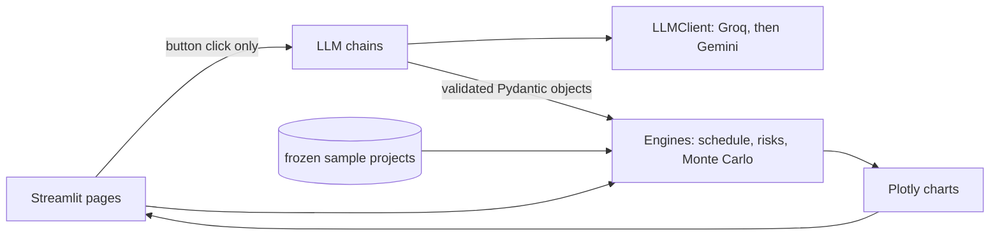

# PlanPilot AI

**One paragraph in, a project plan out:** work breakdown, critical-path schedule, risk register
and a Monte Carlo forecast of the finish date and cost.

The core rule is **the LLM proposes, the code verifies**. An LLM drafts the tasks and risks;
deterministic, seeded, tested Python validates them, schedules them and computes every number
you see. No LLM ever calculates a metric.

> Status: MVP (planning, risk and simulation). Earned-value tracking and the decision module
> are in progress.


## Features

- **Plan:** brief → LLM-drafted WBS with three-point estimates → validation (ids, dependencies,
  cycles, roles) and plan checks (task counts, phases, dead ends, parallelism, timeframe).
  Invalid output is sent back to the LLM with the errors, up to 3 attempts.
- **Schedule:** critical path method (forward and backward pass, slack) on working days, and a Gantt chart.
- **Risks:** LLM-drafted register (cause → event → effect), 5×5 probability × impact heatmap
  scored by code.
- **Simulation:** 10,000 runs with triangular durations and discrete risk events; P50/P80/P90
  finish and cost, probability of meeting the deadline, S-curve, tornado and criticality index.
- **Three environments:** software, event and construction presets with their own roles and rates.
- **Offline demo:** frozen, validated sample projects in `data/sample/` work with no API key.

## Quickstart (Windows PowerShell)

```powershell
git clone https://github.com/krishsarkarofficial/planpilot-ai.git
cd planpilot-ai
python -m venv .venv
.venv\Scripts\Activate.ps1      # if blocked: Set-ExecutionPolicy -Scope CurrentUser RemoteSigned
pip install -r requirements.txt
Copy-Item .env.example .env     # add GROQ_API_KEY (and optionally GEMINI_API_KEY)
streamlit run app/Home.py
```

Run the tests with `pytest -q` and lint with `ruff check .`.

### Offline demo (no API key)

1. Start the app and switch on **Offline** in the sidebar, or set `PLANPILOT_OFFLINE=1`.
2. Click **Load demo project**.
3. Open **Plan**, **Risks** and **Simulation**.

## How it works



- **LLM layer** (`planpilot/llm/`): prompts in `prompts/*.md` with one few-shot example per
  environment. Every response is parsed into Pydantic models, assembled into a `Project`,
  validated and plan-checked; errors trigger a retry. Groq (`openai/gpt-oss-120b`) is primary.
  When its daily quota runs out the client switches to Gemini.
- **Engines** (`planpilot/engine/`): pure Python, no LLM and no network. Triangular sampling uses
  the inverse CDF; each task and risk has its own random stream, so options compared later use
  common random numbers.

## Assumptions and limitations

- Plan quality has no ground truth; the checks catch structural and plausibility problems only.
- Cost model: task cost = sampled duration × daily rate of its role (INR), one person per task.
- Demo projects are synthetic.
- The LLM cannot pin a date inside the plan (for example "the fest is in late January"); tasks
  are scheduled as early as their dependencies allow.

## Author

Krish Sarkar · MIT licence
