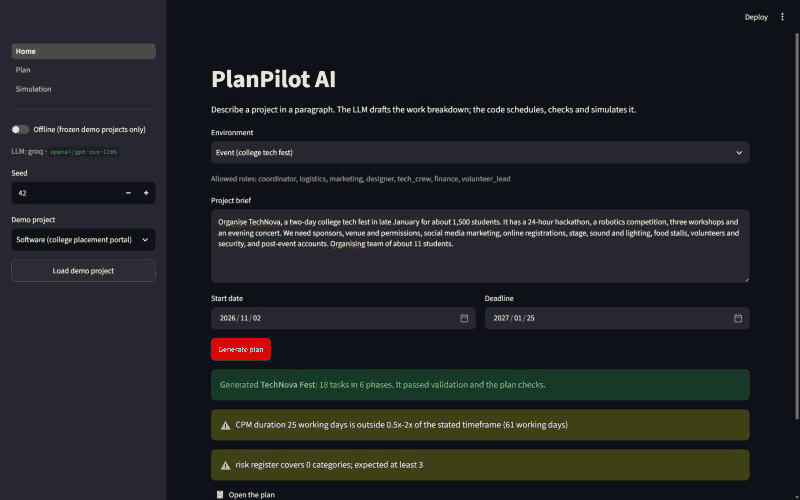
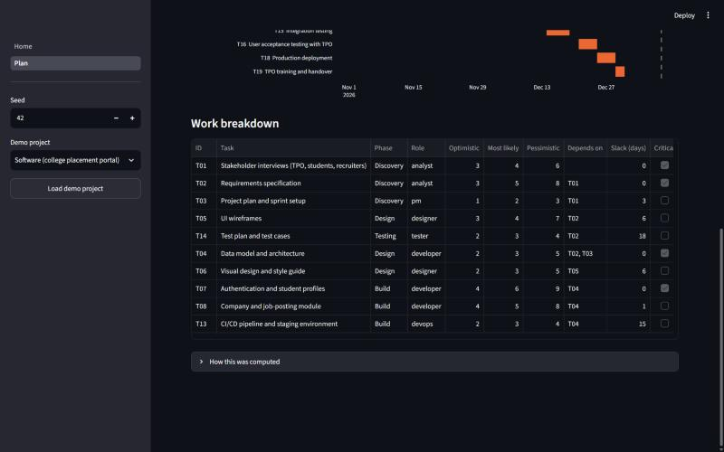
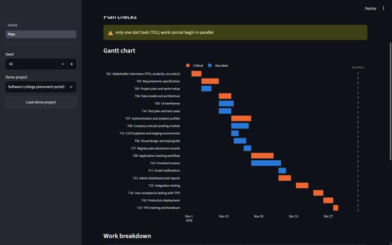
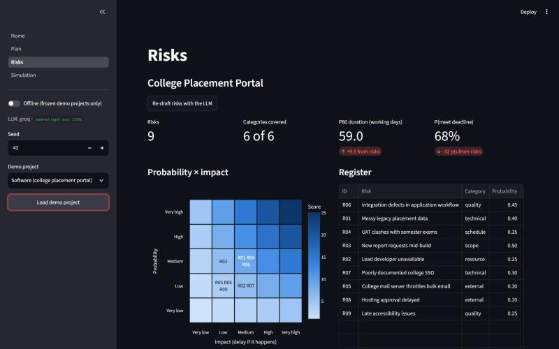
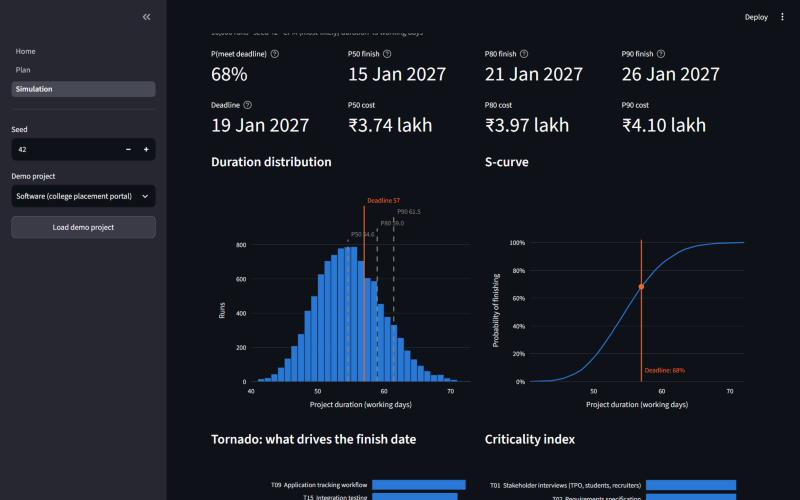
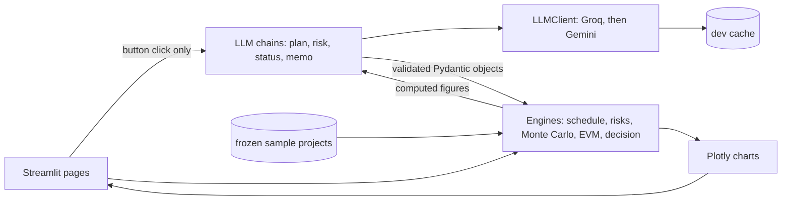

# PlanPilot AI



**One paragraph in, a project plan out:** work breakdown, critical-path schedule, risk register,
Monte Carlo forecast, earned-value status report and a decision memo.

[](https://www.python.org/)
[](LICENSE)
[](https://github.com/krishsarkarofficial/planpilot-ai/actions/workflows/ci.yml)
[](https://streamlit.io/)

PlanPilot AI is a university project on how AI can support project planning, execution, risk
management and decision-making across real project environments. The core rule is **the LLM
proposes, the code verifies**. An LLM drafts tasks, risks and prose; deterministic, seeded,
tested Python validates them, schedules them and computes every number you see. No LLM ever
calculates a metric.

| Theme | What the app does | Who does the work |
|---|---|---|
| Planning | Brief → WBS with three-point estimates and dependencies → CPM schedule, Gantt, plan checks | LLM proposes, code schedules and checks |
| Execution | Weekly progress → PV / EV / AC, SPI / CPI, EAC, RAG status report | Code computes, LLM narrates |
| Risk management | Risk register, 5×5 heatmap, Monte Carlo P50 / P80 / P90, criticality, tornado | LLM drafts, code scores and simulates |
| Decision-making | Options re-simulated, weighted scoring under three weight scenarios, decision memo | Code ranks, LLM writes the memo |

## Features

- **Plan:** brief → LLM-drafted WBS → validation (ids, dependencies, cycles, roles) and plan
  checks (task counts, phases, dead ends, parallelism, timeframe). Invalid output is sent back to
  the LLM with the errors, up to 3 attempts.
- **Schedule:** critical path method (forward and backward pass, slack) on working days, and a
  Gantt chart with the critical path and the deadline.
- **Risks:** LLM-drafted register (cause → event → effect) with a 5×5 probability × impact
  heatmap scored by code.
- **Simulation:** 10,000 runs with triangular durations and discrete risk events; P50 / P80 / P90
  finish and cost, probability of meeting the deadline, S-curve, tornado and criticality index.
- **Execution:** simulated weekly progress from the current plan, PV / EV / AC curves, SPI and CPI
  gauges, EAC, a RAG status and a status report. The report is written by code from a template
  and can be narrated by the LLM; every number it uses is checked against a fact sheet.
- **Decide:** options (add people, cut scope, mitigate risks, extend the deadline) are applied to
  the plan and re-simulated with the same random draws. They are scored on P80 finish, probability
  of meeting the deadline, expected cost and spread under balanced, schedule-first and cost-first
  weights, with a flag for whether the winner changes. A decision memo explains the ranking.
- **Three environments:** software, event and construction presets with their own roles and rates.
- **Offline demo:** frozen, validated sample projects in `data/sample/` work with no API key.

| Plan and checks | Gantt and critical path |
|---|---|
|  |  |
| **Risk register and heatmap** | **Monte Carlo forecast** |
|  |  |

More: [tornado and criticality](docs/images/06_tornado_criticality.jpg),
[earned-value dashboard and status report](docs/images/07_evm_dashboard_rag_report.jpg),
[decision comparison and memo](docs/images/08_decision_comparison_memo.jpg), and the same
pipeline on the [event](docs/images/09a_event_simulation.jpg) and
[construction](docs/images/09b_construction_simulation.jpg) demos.

## Quickstart (Windows PowerShell)

```powershell
git clone https://github.com/krishsarkarofficial/planpilot-ai.git
cd planpilot-ai
python -m venv .venv
.venv\Scripts\Activate.ps1      # if blocked: Set-ExecutionPolicy -Scope CurrentUser RemoteSigned
pip install -r requirements.txt
Copy-Item .env.example .env     # add GROQ_API_KEY (and optionally GEMINI_API_KEY, GEMINI_MODEL)
streamlit run app/Home.py
```

Run the tests with `pytest -q` and lint with `ruff check .`. Python 3.11 is required.

### Offline demo (no API key)

1. Start the app and switch on **Offline** in the sidebar, or set `PLANPILOT_OFFLINE=1`.
2. Pick a demo project (software, event or construction) and click **Load demo project**.
3. Open **Plan**, **Risks**, **Simulation**, **Execution** and **Decide**.

Offline mode never builds an LLM client or touches the network. The demos use frozen projects in
`data/sample/`, not cached responses, so they do not depend on prompt wording. The status report
and decision memo use code-written templates offline.

To regenerate the demo data (deadline calibration to about the baseline P65, progress CSVs):
`python scripts/make_demo_data.py`.

## How it works



- **LLM layer** (`planpilot/llm/`): prompts in `prompts/*.md`, each with a few-shot example. Every
  response is parsed into Pydantic models, assembled into a `Project`, validated and plan-checked;
  errors trigger a retry with the error text appended (up to 3 attempts). Groq
  (`openai/gpt-oss-120b`) is primary; when its daily quota runs out the client switches to Gemini.
  LLM calls happen only inside an explicit button click. The response cache is a development
  convenience, and `use_cache=False` bypasses it fully.
- **Engines** (`planpilot/engine/`): pure Python with no LLM, no Streamlit and no network. Triangular
  sampling uses the inverse CDF (mean (o + m + p) / 3). Each task and risk has its own random
  stream, so options compared in the decision module use common random numbers.
- **Numbers the LLM may use:** the status report and decision memo prompts receive a fact sheet
  computed by code. A number that is not in it, an unknown task or risk id, or a memo
  recommendation that differs from the code's ranking is sent back as an error and retried.
- **Pages** (`app/`) contain UI only; logic lives in `planpilot/`.

## Results

Evaluation is deliberately light, because plan quality has no ground truth.

**Tests and CI.** 119 pytest tests cover the models, schedule and plan checks, Monte Carlo,
earned value, decision options, the LLM layer (mocked provider, retries, cache bypass, offline
mode) and the memo checks. GitHub Actions runs ruff and pytest on Ubuntu with Python 3.11 in
offline mode and no secrets.

**Consistency of the LLM** ([docs/consistency.md](docs/consistency.md)). The plan and risk chains
were run three times for each demo brief with the cache bypassed and temperature 0.7 (9 of 9 runs
valid on Groq):

| Environment | Tasks | Total most-likely days | Critical-path days | Risks |
|---|---|---|---|---|
| Software | 18-22 | 68-87 | 37-46 | 9-10 |
| Event | 18-20 | 70-93 | 30-50 | 9-10 |
| Construction | 16-18 | 64-75 | 30-53 | 9-10 |

Task and risk counts are stable. The critical-path length is not: the same brief can give plans
whose length differs by up to 23 working days. Treat a generated plan as a draft to review.

**Rubric.** [docs/rubric.md](docs/rubric.md) scores one generated plan per environment on eight
criteria (0-2). The rater was an LLM (Claude), not a human, and it helped build the tool, so read
the scores (13 of 16 for each plan) with their written evidence, not as a measurement. The main gaps
it found are short estimates and a few wrong dependencies.

**Decision module on the demo projects** (10,000 runs, seed 42). The recommendation is the winner
under balanced weights; the winner can change with the weights:

| Demo | Baseline P(on time) | Balanced winner | Same winner under all weights? |
|---|---|---|---|
| Software | 68% | Add two developers (96%, ₹6.03 lakh against ₹3.76 lakh) | No: cost-first prefers mitigating risks |
| Event | 69% | Drop the robotics arena | Yes |
| Construction | 65% | Fast-track permit and pre-inspection | No: schedule-first prefers two more masons |

## Limitations and ethics

- **No ground truth.** The plan checks catch structural and plausibility problems only. A plan can
  pass every check and still be a poor plan; a person has to review it.
- **LLM output can be wrong.** The code verifies structure and every figure in the report and
  memo, but not whether prose is sensible. Estimates are the LLM's guesses, and runs vary (see
  the consistency table).
- **Single-person cost model.** Task cost = sampled duration × the daily rate of its role (INR),
  one person-equivalent per task. Headcount only matters for the add-people option.
- **Synthetic data.** The demo projects, rates and progress are synthetic. Execution progress is
  simulated from the plan (with injected slip), not read from real actuals. The budget at
  completion has no risk allowance, so it is lower than the Monte Carlo cost.
- **Decision model simplifications.** Extending the deadline costs nothing in the model, and the
  value of cut scope is not modelled, so both look attractive. Adding people uses an assumed
  efficiency of 0.6. Min-max scoring over few alternatives exaggerates small gaps, so the raw
  values are shown beside the scores.
- **Dates inside a plan.** The LLM cannot pin an event date (for example "the fest is in late
  January"); tasks are scheduled as early as their dependencies allow.
- **Free-tier limits.** Groq and Gemini free tiers rate-limit tokens per minute and per day. The
  client waits once on a per-minute limit and switches to Gemini on a daily limit; otherwise the
  call fails with a clear error.
- **Decision support, not decisions.** Nothing here is financial or professional advice. The memo
  recommends the code's top-ranked option; people decide.

## Roadmap

- Upload real weekly progress (CSV) instead of simulating it.
- Validate against a real project with planned and actual dates.
- Model the cost of extending a deadline and the value of scope.
- Custom weight scenarios and a FastAPI service around the engines.

## Repository layout

```
app/            Streamlit pages (Home, Plan, Risks, Simulation, Execution, Decide)
planpilot/      models, config, engines (schedule, montecarlo, risks, evm, decision), llm, viz
prompts/        prompt templates with few-shot examples
data/sample/    frozen demo projects, progress CSVs and demo options
scripts/        demo data, consistency check, demo GIF
tests/          pytest suite
docs/           screenshots, consistency results, rubric
PLAN.md         scope, specifications, decisions log
```

## References

- Malcolm, D. G., Roseboom, J. H., Clark, C. E. and Fazar, W. (1959). Application of a technique
  for research and development program evaluation. *Operations Research*, 7(5), 646-669.
- Kelley, J. E. and Walker, M. R. (1959). Critical-path planning and scheduling. *Proceedings of
  the Eastern Joint Computer Conference*, 160-173.
- Brooks, F. P. (1975). *The Mythical Man-Month*. Addison-Wesley.
- Fleming, Q. W. and Koppelman, J. M. (2010). *Earned Value Project Management* (4th ed.). Project
  Management Institute.
- Project Management Institute. *A Guide to the Project Management Body of Knowledge (PMBOK Guide)*.

The full reference list is in the report.

## Author

Krish Sarkar · [MIT licence](LICENSE)
